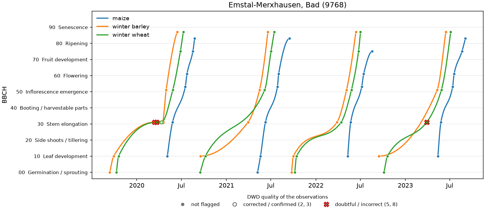
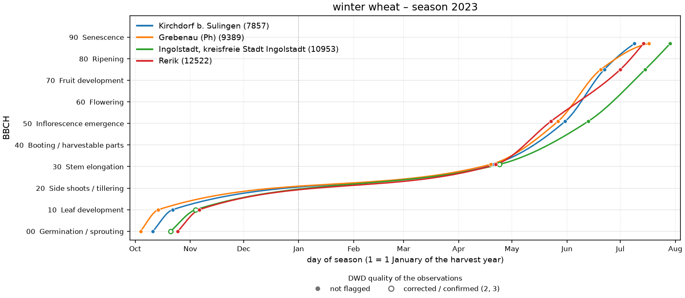
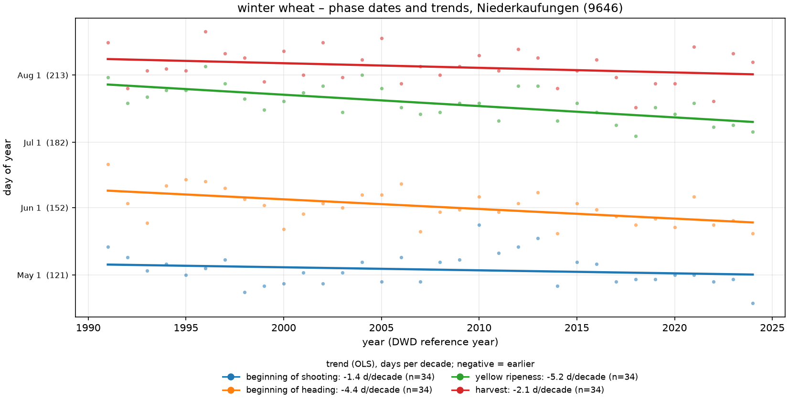
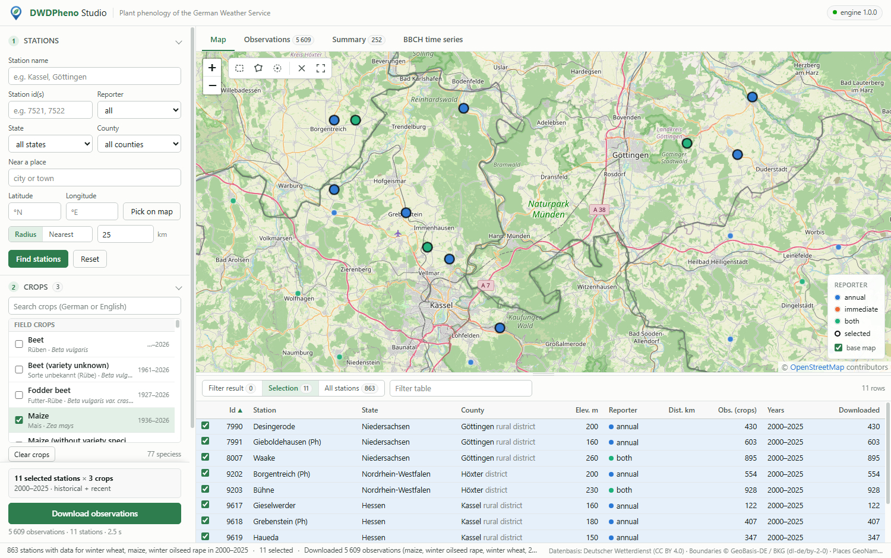
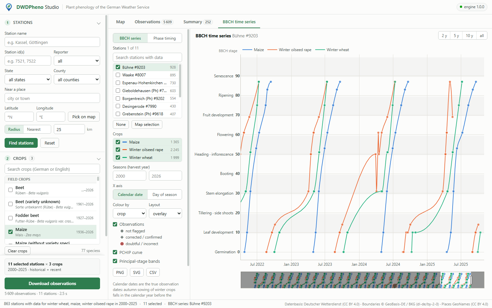
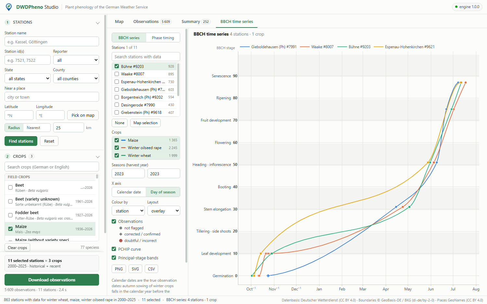
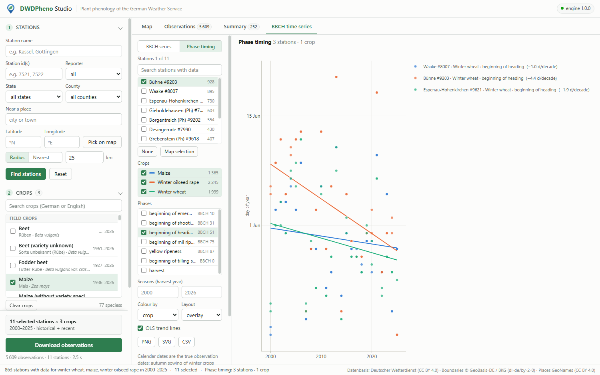
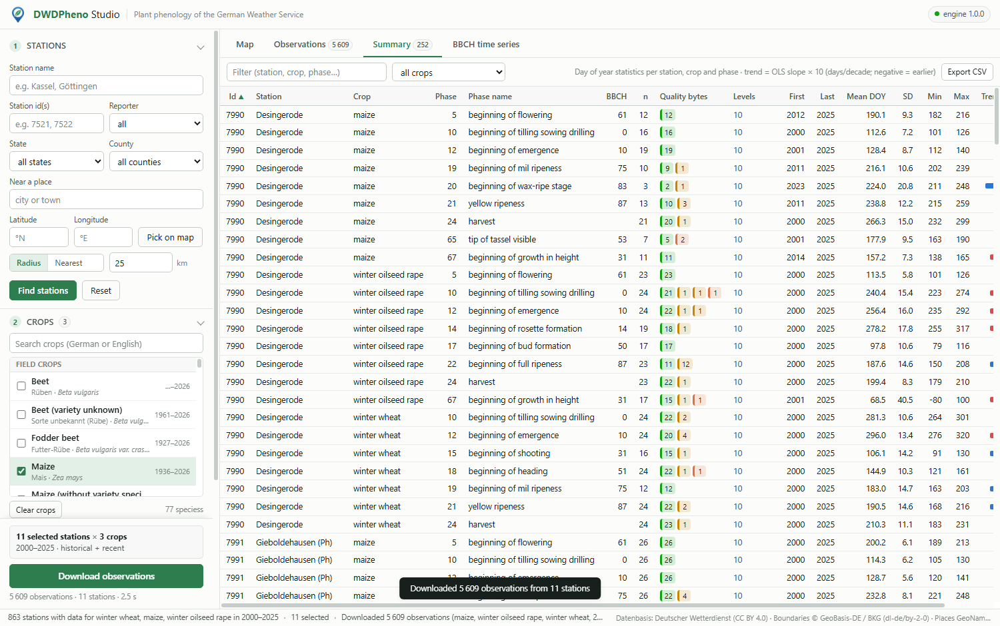

<div align="center">

# DWDPheno

**Plant-phenology observations of the German Weather Service (DWD), as tidy pandas tables**

[](https://pypi.org/project/dwdpheno/)
[](https://pypi.org/project/dwdpheno/)
[](https://github.com/Bluerrror/DWDPheno/actions/workflows/ci.yml)
[](https://github.com/Bluerrror/DWDPheno/blob/main/LICENSE)
[](https://www.dwd.de/copyright)

[Install](#installation) ·
[Quick start](#quick-start) ·
[Stations](#selecting-stations) ·
[Crops](#crops-and-species) ·
[Output](#output-columns) ·
[Quality](#data-quality) ·
[Comparing](#comparing-stations-crops-and-seasons) ·
[BBCH series](#bbch-time-series-and-plots) ·
[CLI](#command-line) ·
[Desktop app](#dwdpheno-studio--desktop-app) ·
[**Web app**](https://bluerror.com/dwdpheno/) ·
[Licences & citations](#licences-data-and-citations)

</div>

---

`dwdpheno` downloads the phenological observations of the
[DWD Climate Data Center](https://opendata.dwd.de/climate_environment/CDC/observations_germany/phenology/):
more than a century of dates at which sowing, emergence, flowering, ripening and harvest were
observed for arable crops, fruit, vines and wild plants at several thousand stations across
Germany.

DWD publishes this as hundreds of fixed-width text files spread over reporter types, plant
groups and historical/recent folders, some in several overlapping versions, with station metadata,
phase definitions and BBCH codes in separate files. `dwdpheno` handles all of that:

- **finds the files** for the crops you name (English or German), using only the newest version
  of each historical file;
- **selects stations** by id, name, federal state, **county**, city, radius, nearest *k*,
  bounding box or polygon. Every station gets its county (BKG VG2500) and nearest place;
- **returns one tidy table** with station metadata, English (plus German and Latin) plant names,
  English phase names, **BBCH codes** and decoded quality flags, with historical/recent
  duplicates removed;
- **builds BBCH time series**: crop cycles are detected from the data and drawn as a
  shape-preserving PCHIP curve, with day-of-year statistics and trends on top;
- **caches** everything on disk, so repeated runs are fast and can work offline.

It depends only on `pandas` and `numpy` (`matplotlib` is optional, for plots) and uses the
standard library for HTTP.

> **Prefer clicking to coding?** [DWDPheno Studio](#dwdpheno-studio--desktop-app) has a map of Germany, station
> selection, downloads and BBCH plots. **Use it in your browser at <https://bluerror.com/dwdpheno/>**
> (nothing to install), or install the desktop app for Windows and Linux from the
> [releases page](https://github.com/Bluerrror/DWDPheno/releases/latest).

## Installation

```bash
pip install dwdpheno            # core
pip install "dwdpheno[plot]"    # + matplotlib for plot_station()
```

Python 3.9 or newer, pandas 1.5 to 3.x.

## Quick start

```python
import dwdpheno as dp

# winter wheat at all stations in the rural district (Landkreis) of Kassel, 2015-2024
obs = dp.download("winter wheat", years=(2015, 2024), county="Kassel rural district")

nk = obs.query("station_name == 'Niederkaufungen' and reporter == 'annual'")
nk[["station_name", "crop", "phase_name", "bbch_code", "date", "day_of_year"]].head(4)
#    station_name         crop                phase_name bbch_code       date  day_of_year
# Niederkaufungen winter wheat     beginning of shooting        31 2015-05-07          127
# Niederkaufungen winter wheat      beginning of heading        51 2015-06-03          154
# Niederkaufungen winter wheat beginning of mil ripeness        75 2015-07-08          189
# Niederkaufungen winter wheat           yellow ripeness        87 2015-07-19          200

stats  = dp.summary(obs)                  # mean / sd / trend of day of year per phase
curves = dp.series(obs)                   # BBCH points + smooth curve per season
dp.plot_station(obs, station_id=9646)     # needs matplotlib

obs.to_csv("wheat_kassel.csv", index=False)
```

From the shell:

```bash
dwdpheno download --crops "winter wheat" --years 2015-2024 --county "Kassel rural district" --out wheat.csv
```

## Selecting stations

`dp.stations(**selection)` returns the station table; `dp.download(crops, **selection)` takes
the same keywords. All criteria you give are combined with AND.

| keyword | CLI | meaning |
|---|---|---|
| `station_id=` | `--station-id 1,2` | exact ids (int, list or `"1,2"`) |
| `name=` | `--name Kassel` | station-name match; a comma or a list means OR |
| `state=` | `--state Hessen` | federal state (Bundesland) |
| `county=` | `--county "Kassel rural district"` | county, matched against `"{county} {county_type} {county_type_de}"`, so `"Landkreis Kassel"` works too |
| `city=` | `--city Göttingen` | centre = best-matching place (exact name first, then largest population) |
| `lat=, lon=` | `--lat 51.3 --lon 9.5` | centre point |
| `radius_km=` | `--radius 25` | km around the centre (default 25 when a centre is given) |
| `nearest=` | `--nearest 5` | the *k* closest stations to the centre (instead of a radius) |
| `bbox=(s, w, n, e)` | `--bbox s,w,n,e` | latitude/longitude box |
| `polygon=[(lat, lon), ...]` | `--polygon "lat lon;lat lon;..."` | point in polygon (even-odd rule) |
| `reporter=` | `--reporter annual\|immediate\|both` | DWD reporter network (default `both`) |
| `active=True` | `--active` | only stations that are still active |

```python
dp.stations(station_id=[9646, 9768])
dp.stations(name="Kaufungen")                       # Niederkaufungen, Oberkaufungen
dp.stations(name="Gießen, Marburg")                 # OR
dp.stations(state="Hessen", active=True)
dp.stations(county="Kassel rural district")         # the rural district only
dp.stations(county="Landkreis Kassel")              # the same, with the German type
dp.stations(county="Kassel")                        # the rural district and the city of Kassel
dp.stations(city="Göttingen", radius_km=30)         # adds distance_km, sorted by distance
dp.stations(lat=51.31, lon=9.49, nearest=5)
dp.stations(bbox=(51.0, 9.0, 51.6, 10.0))
dp.stations(polygon=[(51.0, 9.2), (51.4, 9.2), (51.4, 9.8), (51.0, 9.8)])
dp.stations(reporter="immediate")
```

**Only stations that have data.** Add `crops=` (and optionally `years=`, `partition=`,
`quality=`, `quality_level=`) and you get only the selected stations that actually observed
those crops, with the number of observations and their year range. The counts are exactly what
`download()` would return with the same arguments (the data files are downloaded to count them).
For example, the stations that observed winter wheat in Hessen since 2015:

```python
st = dp.stations(state="Hessen", crops="winter wheat", years=(2015, 2024))
len(st)                                    # 103 (of 577 stations in Hessen)
st.sort_values("n_observations", ascending=False)[
    ["station_id", "station_name", "county", "n_observations", "first_year", "last_year"]].head(3)
#  station_id              station_name         county  n_observations  first_year  last_year
#        9646           Niederkaufungen         Kassel             130        2015       2024
#       14140  Friedberg-Bruchenbrücken  Wetteraukreis             130        2015       2024
#        9593             Margretenhaun          Fulda             129        2015       2024
```

```bash
dwdpheno stations --state Hessen --crops "winter wheat" --years 2015-2024 --out wheat_stations.csv
```

**Text matching** ignores case, umlauts and punctuation: `ä→ae ö→oe ü→ue ß→ss`, accents are
removed, `- _ . , ( )` count as blanks, and a query matches when each of its words appears in the
text. So `"Landkreis Kassel"` matches the county text `"Kassel rural district Landkreis"`,
`"goettingen"` matches `"Göttingen"`, and `"Kassel"` matches both Kassel counties.

**Station table columns**

| column | meaning |
|---|---|
| `station_id` | DWD station id (int) |
| `station_name` | |
| `latitude`, `longitude`, `elevation_m` | WGS84 degrees (4 decimals, as published), metres (integer) |
| `state` | federal state as published by DWD |
| `county`, `county_type`, `county_id` | county (Kreis) from BKG VG2500 point-in-polygon; `county_type` is `rural district` (Landkreis), `district` (Kreis) or `urban district` (Kreisfreie Stadt, Stadtkreis); `county_id` = AGS key, e.g. `06633`; empty outside |
| `nearest_place`, `nearest_place_km` | nearest town/village (GeoNames, population ≥ 1000), km with 2 decimals |
| `naturraumgruppe`, `naturraum` | natural region (group) |
| `active_until` | dissolution date `dd.mm.yyyy`; empty = still active |
| `reporter` | `annual`, `immediate` or `both` |
| `distance_km` | only when the selection has a centre point (2 decimals) |
| `n_observations`, `first_year`, `last_year` | only with `crops=`: observations of those crops at the station (after the year, partition, reporter and quality filters and the historical/recent de-duplication) and their year range |

Places can be searched directly: `dp.places("Frankfurt")` returns `name, latitude, longitude,
population, state`.

## Crops and species

Crop, plant and phase names come from DWD's own reference tables
([`PH_Beschreibung_Pflanze.txt`](https://opendata.dwd.de/climate_environment/CDC/help/PH_Beschreibung_Pflanze.txt)
for English, German and Latin plant names,
[`PH_Beschreibung_Phase.txt`](https://opendata.dwd.de/climate_environment/CDC/help/PH_Beschreibung_Phase.txt)
for English phase names). Every DWD file token (`Winterweizen`, `Apfel_fruehe_Reife`, …) is
matched to its plant, which gives this catalog:

```python
dp.crops()
#                   crop            crop_de            species  objekt_id           dwd_token  group         reporters  first_year  last_year  files
#                   beet              Rüben      Beta vulgaris         25               Ruebe  crops  annual;immediate        <NA>       2026      3
#           spring wheat       Sommerweizen  Triticum aestivum        206        Sommerweizen  crops            annual        1927       1990      1
#           winter wheat       Winterweizen  Triticum aestivum        202        Winterweizen  crops  annual;immediate        1925       2026      4
#                  apple              Apfel    Malus domestica        310               Apfel  fruit  annual;immediate        1925       2026      4
# apple (early ripeness) Apfel, frühe Reife    Malus domestica        311  Apfel_fruehe_Reife  fruit            annual        1929       2026      2
# ...                                                                  (77 crops, sorted by group and English name)
```

`first_year`/`last_year` come from the historical file names; when a crop also has a recent
file, `last_year` is the current year (a few files carry no years at all). `group` is one of
`crops wild fruit vine farming`.

**Naming crops.** You can use the English name, the German name or the DWD token, in any case
and with or without umlauts:

1. a name that **equals** a crop's English name, German name or token selects exactly that crop:
   `"apple"` gives only *apple*, `"Apfel_fruehe_Reife"` only *apple (early ripeness)*;
2. otherwise **every word you give must be the start of a word** of one of the names:
   `"wheat"` gives *winter wheat* and *spring wheat*, `"app"` all three apples, `"lime"` both
   lime trees, and `"apple early"` the early-ripening apples. `"ash"` gives *ash* but not
   *rowan* (*Eberesche*).

```python
dp.download("winter wheat", ...)            # one crop
dp.download(["winter barley", "maize"], ...)
dp.download("Apfel", ...)                   # German name
dp.download("wheat", ...)                   # winter + spring wheat
```

In the downloaded data, `crop` / `crop_de` / `species` are the English / German / Latin names of
each row's plant (`objekt_id`).

### Phases and BBCH codes

```python
dp.phases("winter wheat")
# objekt_id          crop  phase_id                            phase_name bbch_code
#       202  winter wheat        10  beginning of tilling sowing drilling         0
#       202  winter wheat        12                beginning of emergence        10
#       202  winter wheat        15                 beginning of shooting        31
#       ...
#       202  winter wheat        24                               harvest      <NA>

dp.find_bbch(5)                  # every plant that uses phase_id 5
dp.bbch_for(18, objekt_id=202)   # '51' (winter wheat, beginning of heading)
```

Phase names are DWD's English phase names. BBCH codes come from the phase definitions of each
plant group; phases without a BBCH code (e.g. harvest) have an empty `bbch_code`.

## Years

`years` takes `2005`, an inclusive range `(2000, 2020)`, a list `[1990, 1995, 2000]`, or
`None` for everything (the CLI uses `2005`, `2000-2020` or `1990,1995`). It filters on DWD's
reference year (*Referenzjahr*). For winter crops that is the harvest year, and the autumn
sowing of the next crop falls in the same reference year (see
[BBCH time series](#bbch-time-series-and-plots)).

## Output columns

`dp.download()` returns one row per observation, sorted by `crop, station_id, year, date, phase_id`.
Everything is in English except the proper names of places (stations, states, counties, natural
regions).

| column | meaning |
|---|---|
| `station_id`, `station_name`, `latitude`, `longitude`, `elevation_m`, `state`, `county` | station metadata |
| `crop`, `crop_de`, `species` | English, German and Latin name of the row's plant, e.g. `winter wheat`, `Winterweizen`, `Triticum aestivum` |
| `objekt_id` | DWD plant id |
| `phase_id`, `phase_name` | phenological phase (English name from DWD, e.g. `beginning of heading`) |
| `bbch_code` | BBCH code as text (`"31"`); empty when DWD defines none |
| `year` | DWD's reference year (*Referenzjahr*; the harvest year) |
| `date` | date of the observation (`datetime64`; ISO `YYYY-MM-DD` in files) |
| `day_of_year` | day of year as published by DWD (*Jultag*) |
| `quality_byte`, `quality_byte_meaning` | `1` not flagged, `2` corrected, `3` confirmed despite flag, `5` doubtful, `8` incorrect, `0` no quality byte |
| `quality_level`, `quality_level_meaning` | `1` pre-load check only, `2` pre-load check (immediate reporters), `7` ROUTKLI checked, `10` ROUTKLI checked + corrected |
| `reporter` | `annual` (Jahresmelder) or `immediate` (Sofortmelder) |
| `partition` | `historical` or `recent` |
| `source_file` | DWD file the row came from |

Where the historical and recent files overlap, rows are de-duplicated on
`(station_id, objekt_id, phase_id, year, reporter)` and the recent row is kept.

Other options: `partition="historical" | "recent" | "both"`, `reporter=...`,
`quality=` / `quality_level=` (see [Data quality](#data-quality); default: keep everything),
`verbose=True` (progress on stderr) and `progress=callback(i, n, text)`.

## Data quality

Every DWD observation carries two quality flags, and `dwdpheno` keeps both:

| quality byte (`quality_byte`) | meaning | | quality level (`quality_level`) | meaning |
|---|---|---|---|---|
| `1` | not flagged | | `1` | pre-load check only |
| `2` | corrected | | `2` | pre-load check (immediate reporters) |
| `3` | confirmed despite flag | | `7` | ROUTKLI checked |
| `5` | doubtful | | `10` | ROUTKLI checked + corrected |
| `8` | incorrect | | | |
| `0` | no quality byte (a missing byte counts as `0`) | | | |

**By default nothing is filtered**: every observation is returned, and its quality is shown in
the download columns, in the `series` point rows, in the `summary` counts and in the plot. To
keep only some codes, pass `quality=` (quality bytes) and/or `quality_level=` (quality levels)
to `download`, `series`, `summary` or `plot_station`, or `--quality` / `--quality-level` on the
command line:

```python
obs   = dp.download("winter wheat", years=(2015, 2024), county="Kassel rural district")
clean = dp.download("winter wheat", years=(2015, 2024), county="Kassel rural district",
                    quality=[1, 2, 3])            # drop doubtful (5), incorrect (8), no byte (0)
dp.download("winter wheat", county="Kassel rural district", quality_level=[7, 10])  # checked only

dp.series(obs, quality=[1, 2, 3])                  # same options on an existing table
dp.summary(obs, quality=[1, 2, 3])
dp.plot_station(obs, 9768, quality=[1, 2, 3])
```

```bash
dwdpheno download --crops "winter wheat" --county "Kassel rural district" --quality 1,2,3 --out clean.csv
dwdpheno summary --in wheat.csv --quality-level 7,10 --out summary.csv
```

In the downloaded table the historical/recent de-duplication happens first and the quality
filter afterwards, so a filtered-out recent row never lets an older historical copy back in.
`summary()` reports how many observations of each phase had which flag; at Bad
Emstal-Merxhausen (9768) two doubtful early "beginning of shooting" dates noticeably change the
trend:

```python
dp.summary(obs).query("station_id == 9768 and phase_id == 15")
#  n  mean_doy  sd_doy  trend_days_per_decade  n_not_flagged  n_corrected  n_confirmed  n_doubtful  n_incorrect  n_no_quality_byte  quality_levels
# 15     95.27    6.72                  -6.08             11            1            1           2            0                  0            7;10
dp.summary(obs, quality=[1, 2, 3]).query("station_id == 9768 and phase_id == 15")
# 13     96.92    5.33                  -1.21             11            1            1           0            0                  0            7;10
```


## BBCH time series and plots

DWD's reference year (*Referenzjahr*) is not a crop cycle. For winter wheat, year 2024 holds the April–July 2024
stages and also the October 2024 sowing of the next crop. `dp.series()` therefore finds the
cycles in the data:

1. per station and crop, take the observations with a numeric BBCH code (all of them, unless
   you pass `quality=` / `quality_level=`) and sort them by date;
2. start a new cycle when BBCH drops by more than 20 below the cycle's maximum (harvest → sowing)
   or when more than 300 days pass between two observations;
3. `season` is the calendar year of the cycle's last observation, i.e. the harvest year. A cycle
   that is not finished yet (sown in autumn, no spring data yet) would get the same year as the
   cycle before it; it gets the previous season + 1 instead;
4. inside each cycle BBCH is interpolated over time with the monotone piecewise-cubic Hermite
   interpolant (**PCHIP**, Fritsch–Carlson). It keeps the shape of the data and does not overshoot.

```python
s = dp.series(obs, station_id=9646, crops="winter wheat", step_days=1)
#  kind  station_id          crop  season        date        t  season_doy   bbch  phase_id                            phase_name  quality_byte  quality_byte_meaning  quality_level        quality_level_meaning
# point        9646  winter wheat    2024  2023-10-03  19633.0      -89.00   0.00        10  beginning of tilling sowing drilling             1           not flagged             10  ROUTKLI checked + corrected
# point        9646  winter wheat    2024  2023-10-03  19633.0      -89.00   0.00        10  beginning of tilling sowing drilling             1           not flagged              7              ROUTKLI checked
#   ...
# curve        9646  winter wheat    2024  2023-10-04  19634.0      -88.00   0.84      <NA>                                  <NA>          <NA>                  <NA>           <NA>                         <NA>
```

`kind` is `point` (an observation) or `curve` (a sample every `step_days` from the first to the
last observation of the cycle, both ends included). `t` is days since 1970-01-01 and
`season_doy` the day of the season (1 = 1 January of the harvest year, negative = the autumn
before); `t`, `season_doy` and `bbch` are rounded to 2 decimals. `station_id` and `crops` take
lists. Point rows carry the observation's quality flags; curve rows
leave the phase and quality columns empty.

```python
import dwdpheno as dp

obs = dp.download(["winter wheat", "winter barley", "maize"], years=(2015, 2024),
                  county="Kassel rural district")
ax = dp.plot_station(obs, station_id=9768, years=(2020, 2023))
ax.figure.savefig("bbch_series.png", dpi=150)
```

<p align="center">
  
</p>

`plot_station(obs, station_id, crops=None, ax=None, years=None, quality=None, quality_level=None)`
draws real dates on the x axis, the BBCH principal growth stages (0–90) on the y axis, and one
colour per crop, with the observations as points and a smooth curve per crop cycle. The markers
show the DWD quality: filled dots are not flagged (or have no quality byte), hollow circles are
corrected or confirmed despite a flag, and crosses with a red edge are doubtful or incorrect
(above: early "beginning of shooting" reports in March 2020 and March 2023). Pass `ax=` to draw
into your own figure.

## Comparing stations, crops and seasons

`dp.plot_series()` draws any number of stations, crops and seasons together. Pick the x axis,
what the colours stand for, and optionally one panel per station or crop:

| argument | values | |
|---|---|---|
| `station_id`, `crops`, `years` | one or several (default: everything in `obs`) | what to draw |
| `x` | `"date"` (real dates) or `"season_doy"` | `season_doy` puts every season on one axis: day 1 = 1 January of the harvest year, negative = the autumn before |
| `color_by` | `"crop"`, `"station"` or `"season"` | one colour per value |
| `facet` | `None`, `"station"` or `"crop"` | small multiples with shared axes |

When a second key also varies (e.g. several crops while colouring by station), it gets its own
line styles and legend. The quality markers are the same as in `plot_station()`, which is now a
shorthand for `plot_series(obs, station_id, x="date", color_by="crop")`.

Winter wheat in season 2023 at four stations from the Baltic coast to Bavaria:

```python
obs = dp.download("winter wheat", years=(2022, 2023), reporter="annual")
ax = dp.plot_series(obs, station_id=[12522, 7857, 9389, 10953], years=2023,
                    x="season_doy", color_by="station")
```

<p align="center">
  
</p>

All four reached stem elongation (BBCH 31) within five days of each other (days 109–114, around
20 April), but Ingolstadt headed 13–21 days later than the others (day 164 against 143–151) and
reached yellow ripeness on day 210 against 190–198.

Other combinations:

```python
dp.plot_series(obs, station_id=9389, x="season_doy", color_by="season")   # one station, seasons overlaid
dp.plot_series(obs, station_id=[12522, 10953], x="season_doy",
               color_by="season", facet="station")                        # one panel per station

three = dp.download(["winter wheat", "winter barley", "maize"], years=(2021, 2023), station_id=9768)
dp.plot_series(three, x="season_doy", color_by="crop")                     # crops; seasons as line styles
```

`series()` gives the same day-of-season values in its `season_doy` column, for your own plots.

### Phase dates over the years

`dp.plot_phase_trend()` plots the day of year of phenological phases against the year, with an
OLS trend line per phase and the trend in days per decade in the legend. Phases are given by id
or English name (`"heading"` finds *beginning of heading*); several stations are pooled per crop
and phase. For a single station the trends are the same as `summary()`'s `trend_days_per_decade`.

```python
long = dp.download("winter wheat", years=(1991, 2024), station_id=9646, reporter="annual")
ax = dp.plot_phase_trend(long, phases=["beginning of shooting", "beginning of heading",
                                       "yellow ripeness", "harvest"])
```

<p align="center">
  
</p>

At Niederkaufungen, heading has moved 4.4 days per decade earlier since 1991 and yellow ripeness
5.2 days per decade, while shooting changed little (1.4 days per decade).

## Summary statistics

```python
dp.summary(obs)
# station_id          crop  objekt_id  phase_id             phase_name  bbch_code   n  first_year  last_year  mean_doy  sd_doy  min_doy  max_doy  trend_days_per_decade
#       9646  winter wheat        202        15  beginning of shooting         31  20        2015       2024    119.45    5.03      108      127                 -13.00
```

One row per `(station_id, crop, objekt_id, phase_id)` with the number of observations, the year
range and the mean, sample standard deviation, minimum and maximum day of year.
`trend_days_per_decade` is the OLS slope of day of year on year × 10, left empty when n < 3.
Mean, standard deviation and trend are rounded to 2 decimals. The last columns count the
observations per quality byte (`n_not_flagged, n_corrected, n_confirmed, n_doubtful,
n_incorrect, n_no_quality_byte`) and list the quality levels found (`quality_levels`, e.g.
`7;10`); `summary(obs, quality=..., quality_level=...)` filters first.

## Command line

The `dwdpheno` command (also available as `python -m dwdpheno`) covers the same functions:

```text
dwdpheno stations  [selection] [--crops A,B [--years ...] [--partition ...] [quality]]
                   [--format csv|json] [--out FILE]
dwdpheno crops     [--format csv|json] [--out FILE]
dwdpheno phases    [--crops A,B] [--format csv|json] [--out FILE]
dwdpheno download  --crops A,B [--years 2000-2020|2005|1990,1995] [selection] [quality]
                   [--partition historical|recent|both] [--format csv|json] [--out FILE]
dwdpheno series    --in OBS.csv [--station-id N] [--crops A] [--step-days 1] [quality] [--format csv|json] [--out FILE]
dwdpheno summary   --in OBS.csv [quality] [--format csv|json] [--out FILE]
dwdpheno places    --q NAME [--limit N] [--format csv|json] [--out FILE]
dwdpheno plot      --in OBS.csv [--station-id N,M] [--crops A,B] [--years 2019-2024]
                   [--x date|season_doy] [--color-by crop|station|season] [--facet station|crop]
                   [quality] --out FILE.png
dwdpheno plot-trend --in OBS.csv [--phases ID|NAME,...] [--station-id N,M] [--crops A] [--years ...]
                   [quality] --out FILE.png
dwdpheno version

selection:  --station-id --name --state --county --city --lat --lon --radius --nearest
            --bbox --polygon --reporter --active
quality:    --quality 1,2,3  --quality-level 7,10      (default: keep everything)
global:     --cache DIR|off  --offline  --quiet  --max-age-days 1  --data DIR
```

```bash
dwdpheno stations --city Göttingen --radius 20
dwdpheno stations --state Hessen --crops "winter wheat" --years 2015-2024
dwdpheno crops --format json --out crops.json
dwdpheno download --crops apple,pear --years 1990-2024 --state Sachsen --active --out fruit.csv
dwdpheno series --in fruit.csv --station-id 12345 --step-days 7 --out series.csv
dwdpheno summary --in fruit.csv --quality 1,2,3 --out summary.csv
dwdpheno plot --in fruit.csv --station-id 12345 --years 2015-2024 --out station.png
dwdpheno plot --in fruit.csv --station-id 12345,23456 --x season_doy --color-by station --years 2020 --out compare.png
dwdpheno plot-trend --in fruit.csv --phases "beginning of flowering" --out flowering_trend.png
```

- Without `--out`, results go to stdout. CSV is comma-separated UTF-8 with empty cells for
  missing values. JSON is an array of objects with `null` for missing values.
- Progress goes to stderr as `PROGRESS <i> <n> <text>` (turn it off with `--quiet`); errors go
  to stderr as `ERROR <text>`.
- Exit codes: `0` ok, `1` usage error, `2` no match, `3` network or I/O error.

## Caching and offline use

Every downloaded file is kept in a local cache:

| platform | default location |
|---|---|
| Windows | `%LOCALAPPDATA%\dwdpheno\cache` |
| Linux / macOS | `$XDG_CACHE_HOME/dwdpheno`, else `~/.cache/dwdpheno` |

or wherever the `DWDPHENO_CACHE` environment variable points. `dp.default_cache_dir()` shows
the path in use.

- Historical data files (`*_hist.txt`) never change and are never downloaded again.
- Directory listings, station metadata, phase definitions and recent files are refreshed after
  `max_age_days` (default 1).
- `offline=True` (`--offline`) uses only what is already cached. `cache=False` (`--cache off`)
  turns the cache off, and `cache="path"` uses another folder.
- If a refresh fails because of a network problem, the stale copy is used and a warning is
  issued.

Every function that talks to DWD (`stations`, `crops`, `phases`, `download`) accepts `cache=`,
`offline=` and `max_age_days=`.

Large crops come in large historical files (winter wheat is about 140 MB), because DWD
publishes one file per crop for all stations. The first download takes a while; after that,
selections run from the cache in seconds.

## DWDPheno Studio — desktop app
<!-- STUDIO:BEGIN -->
<p align="center"></p>

**DWDPheno Studio** is a desktop application for the same data, for people who'd rather click than
code. Its engine is native Fortran, and it shows the data on a map and in charts. Everything in it
is in English except the local names of stations and places.

- **Map of Germany** with every active DWD phenology station, state and county outlines, and an
  OpenStreetMap base map. Pick stations by clicking, with a box or lasso, by name or id, by state
  or county, around a place or coordinate (radius or nearest *k*).
- **Only stations with data**: as soon as you choose crops and years, the map, the tables and the
  selection tools show only the stations that observed those crops in those years, with the
  number of observations and the year range.
- **77 crops and wild plants** with their English, German and Latin names, years and partitions,
  and one-click download with progress and cancel.
- **Data quality**: every DWD quality byte and quality level can be switched on or off. By
  default nothing is filtered, and the quality is shown in the observation table, the summary and
  on every plotted point.
- **BBCH time series**: the observed stages on their true dates, joined per season by a smooth,
  monotone PCHIP curve. Several stations, crops and seasons can be overlaid or shown as small
  multiples, on calendar dates or on a common *day-of-season* axis.
- **Phase timing**: the day of year of any phase against year, with OLS trend lines in days per decade.
- **Summary table** with day-of-year statistics and trends per station, crop and phase, and CSV,
  PNG and SVG export of every table and figure.

<table>
<tr>
<td></td>
<td></td>
</tr>
<tr>
<td align="center"><sub>BBCH stages on their true dates with the PCHIP curve per season</sub></td>
<td align="center"><sub>Four stations compared on the day-of-season axis</sub></td>
</tr>
<tr>
<td></td>
<td></td>
</tr>
<tr>
<td align="center"><sub>Heading dates per year and trend for three stations</sub></td>
<td align="center"><sub>Summary statistics with the quality of the observations</sub></td>
</tr>
</table>

### Use it online

Open **<https://bluerror.com/dwdpheno/>** in any modern browser. Nothing to install, and it is the
same application as the desktop version. The online version allows up to 20 crops per download, and a
download stops after 10 minutes. For larger downloads, use the desktop app or the Python package.

### Download and install

Installers are attached to every [GitHub release](https://github.com/Bluerrror/DWDPheno/releases/latest).
No Python is needed: the engine is Fortran and the application is .NET with a web view, and
everything it needs is inside the installer.

| Platform | File | How to install |
|---|---|---|
| **Windows 10 / 11** (x64) | `DWDPheno-Studio-1.0.0-setup.exe` | Run it. It installs for the current user without administrator rights (or for all users, if you choose). It uses the Microsoft Edge WebView2 runtime, which comes with Windows 11 and is installed automatically when missing. |
| **Linux** (x64, any distribution) | `DWDPheno-Studio-1.0.0-linux-x64.run` | `chmod +x DWDPheno-Studio-1.0.0-linux-x64.run && ./DWDPheno-Studio-1.0.0-linux-x64.run` installs into `~/.local` (run it with `sudo` to install into `/opt` for all users; `--uninstall` removes it). |
| **Debian / Ubuntu** | `dwdpheno-studio_1.0.0_amd64.deb` | `sudo apt install ./dwdpheno-studio_1.0.0_amd64.deb` |
| **Linux** (manual) | `dwdpheno-studio-1.0.0-linux-x64.tar.gz` | `tar xf dwdpheno-studio-1.0.0-linux-x64.tar.gz && cd dwdpheno-studio-1.0.0 && ./install.sh` |

On Linux, start **DWDPheno Studio** from the application menu or run `dwdpheno-studio`. It opens in
your web browser at `http://127.0.0.1:8060` (the server listens on this computer only). The Linux
build needs the system packages `libgfortran5` and `curl`. The `.deb` installs them, and the `.run`
installer does so when run with `sudo`.

Downloaded DWD files are cached in `%LOCALAPPDATA%\DWDPheno\cache` (Windows) or
`~/.local/share/DWDPheno/cache` (Linux). Historical files are kept for good, and listings and recent
files are refreshed daily.

DWDPheno Studio is free for scientific, educational and personal use. It is distributed as
installers only, and its licence is shown during installation. The Python package in this
repository is MIT-licensed open source.
<!-- STUDIO:END -->

## Licences, data and citations

The `dwdpheno` code is MIT-licensed. The data it downloads and bundles keep their own licences, and
these require attribution whenever you publish or redistribute them:

| Source | Licence | Credit line |
|---|---|---|
| Phenological observations, station metadata, phase definitions: Deutscher Wetterdienst (DWD), Climate Data Center, <https://opendata.dwd.de/climate_environment/CDC/observations_germany/phenology/> | [CC BY 4.0](https://creativecommons.org/licenses/by/4.0/) ([DWD terms](https://www.dwd.de/copyright)) | unchanged data: `Quelle: Deutscher Wetterdienst`; changed data: `Datenbasis: Deutscher Wetterdienst, <what you changed>`, e.g. `..., Einzelwerte gemittelt` |
| Administrative boundaries VG2500 (bundled in `dwdpheno/data/`): Bundesamt für Kartographie und Geodäsie | [dl-de/by-2-0](https://www.govdata.de/dl-de/by-2-0) ([BKG terms](https://sgx.geodatenzentrum.de/web_public/gdz/lizenz/deu/nutzungsbedingungen_vg2500.pdf)) | `© BKG (2026) dl-de/by-2-0 (Daten verändert), Datenquellen: https://sgx.geodatenzentrum.de/web_public/gdz/datenquellen/datenquellen_vg_nuts.pdf` |
| Places (bundled in `dwdpheno/data/cities.txt`): [GeoNames](https://www.geonames.org/) | [CC BY 4.0](https://creativecommons.org/licenses/by/4.0/) | `GeoNames (https://www.geonames.org/), CC BY 4.0` |

BBCH principal growth stages follow Meier, U. (ed.) (2018), *Growth stages of mono- and
dicotyledonous plants: BBCH Monograph*, Open Agrar Repositorium, <https://doi.org/10.5073/20180906-074619>
(CC BY 4.0). The BBCH curves use monotone piecewise-cubic Hermite interpolation (Fritsch & Carlson
1980, <https://doi.org/10.1137/0717021>; Fritsch & Butland 1984, <https://doi.org/10.1137/0905021>);
trends are ordinary least-squares slopes. DWDPheno Studio's base map is © [OpenStreetMap](https://www.openstreetmap.org/copyright)
contributors (ODbL).

[**THIRD_PARTY_NOTICES.md**](https://github.com/Bluerrror/DWDPheno/blob/main/THIRD_PARTY_NOTICES.md)
lists every dataset, method, library and service used by the package and by DWDPheno Studio, with
licences, required source notes, references and where each licence was checked. The bundled
reference data can be rebuilt with `python tools/build_data.py`.

This package is not affiliated with or endorsed by the DWD, the BKG or GeoNames.

## Citation

If `dwdpheno` helps your work, please cite it (see [`CITATION.cff`](https://github.com/Bluerrror/DWDPheno/blob/main/CITATION.cff), or use
GitHub's "Cite this repository" button) and credit the DWD as the data source:

```bibtex
@software{shojaeezadeh_dwdpheno,
  author  = {Shojaeezadeh, Shahab A.},
  title   = {dwdpheno: download plant-phenology observations of the German Weather Service (DWD)},
  version = {1.0.0},
  year    = {2026},
  url     = {https://github.com/Bluerrror/DWDPheno},
  license = {MIT}
}
```

## Contributing

Issues and pull requests are welcome. See [CONTRIBUTING.md](https://github.com/Bluerrror/DWDPheno/blob/main/CONTRIBUTING.md). The tests run
offline against trimmed real DWD files: `pip install -e ".[test,plot]"` and then `pytest`.

## Licence

[MIT](https://github.com/Bluerrror/DWDPheno/blob/main/LICENSE) © 2026 Shahab A. Shojaeezadeh
